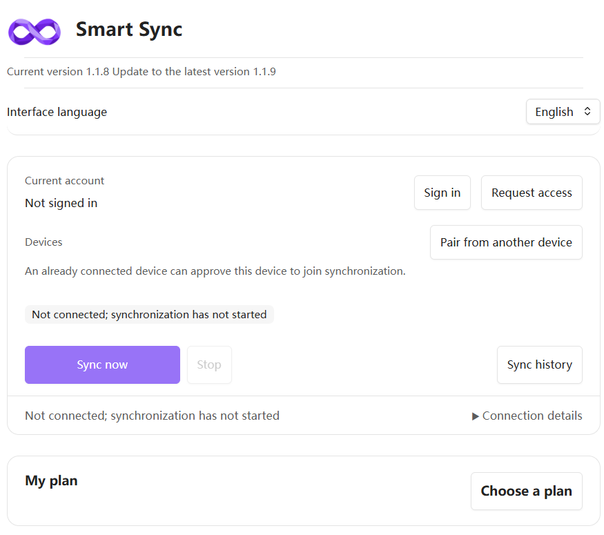

# Smart Sync 

**End-to-end encrypted sync for Obsidian — with LAN acceleration when your devices are on the same network.**

Your notes, attachments and file paths are encrypted on your device with AES-256-GCM before anything is uploaded. The server only ever stores ciphertext, and your encryption passphrase is separate from your account login — we can't read your notes, and we can't recover a lost passphrase.

- 🔒 **Private by design** — AES-256-GCM encryption on your device; passphrase separate from account login
- 🏠 **LAN acceleration** — devices on the same Wi-Fi sync directly, with cloud fallback when they don't
- 🆓 **Free to start** — 50 MB, 1 vault, unlimited devices; paid plans from $1/month
- 🛠 **More than files** — version history and recovery, device pairing, folder sorting, per-note encryption, and sync for selected settings, plugins and themes

<!-- LANGUAGES:START -->

[English](README.md) · [German](docs/i18n/de/README.md) · [French](docs/i18n/fr/README.md) · [Spanish](docs/i18n/es/README.md) · [Brazilian Portuguese](docs/i18n/pt-BR/README.md) · [Russian](docs/i18n/ru/README.md) · [Simplified Chinese](docs/i18n/zh-CN/README.md) · [Traditional Chinese](docs/i18n/zh-TW/README.md) · [Japanese](docs/i18n/ja/README.md) · [Korean](docs/i18n/ko/README.md)

<!-- LANGUAGES:END -->

## Start syncing in about a minute

1. Install **Smart Sync** from Obsidian's Community plugins and enable it.
2. Open **Settings → Smart Sync → Sign in** (Google, GitHub or email).
3. Create a cloud vault and set your encryption passphrase — that's it, sync runs automatically.

Full walkthrough: [USER-GUIDE.md](USER-GUIDE.md)

[Website](https://smartsync.cc/) · [Plans](https://smartsync.cc/pricing/) · [Download / update](https://smartsync.cc/download/)

> Requires Obsidian **1.12.7 or newer**. Current stable release: **1.1.9**.

<em>Smart Sync settings — sign in, pair a device, and sync from one panel.</em>

## Get started

### Install from Obsidian Community plugins

Once Smart Sync is listed in the Obsidian community directory, you can install it directly in Obsidian:

1. Open Settings → Community plugins in Obsidian.
2. If community plugins are disabled, select Turn on community plugins and review the notice shown by Obsidian.
3. Select Browse, search for Smart Sync, and open its listing (author: lihy).
4. Select Install, then Enable.

### Wujie Hub or manual download

In Wujie Hub, choose **Smart Sync → Stable** for the current stable package.

For manual installation, download `main.js`, `manifest.json` and `styles.css` from the matching [GitHub Release](https://github.com/adventurer2008/obsidian-smart-sync-release-global/releases). Check its `SHA256SUMS.txt`. Place the three files in `<vault>/.obsidian/plugins/smart-sync-global/` (or your custom configuration folder's `plugins/smart-sync-global/`). Reload Obsidian, then enable Smart Sync in Community plugins after reviewing the host's trust prompt yourself.

## Sign in and connect your first vault

1. Open **Settings → Smart Sync → Sign in**, choose Google, GitHub or email, then create or select a cloud vault. Keep its encryption passphrase safe; account login cannot recover it.
2. Review sync preferences, run synchronization and confirm completion before adding another device. Follow the [step-by-step manual](USER-GUIDE.md) for pairing, recovery and troubleshooting.

## Features

- Notes-first synchronization, attachment download policies, exclusions, task progress and optional LAN acceleration with cloud fallback.
- History and deleted-note recovery within retention limits, device pairing/revocation and encrypted configuration recovery.
- Selected Obsidian settings, compatible plugins, themes and snippets synchronized across devices.
- Folder-level sorting, pinned/bottom notes, recent files and local note search.
- Password-protected whole notes or selected text, secure editing and encrypted draft recovery. Titles, linked attachments and earlier plaintext history have separate privacy boundaries.
- Desktop tray where supported and optional Windows launch at login. Mobile systems can suspend background work; return to Obsidian and confirm uploads finish.

## Account, payments and privacy

The Global application server runs on Oracle Cloud in the United States. Encrypted object data is stored privately using Cloudflare R2.

Hosted synchronization requires an account. The Free plan includes 50 MB, one cloud vault and unlimited devices; paid plans add capacity. Payments are charged in USD. Stripe is the default provider; some accounts may be assigned Dodo Payments. Existing orders and subscriptions stay with their original provider. Review [plans](https://smartsync.cc/pricing/) and [terms](https://smartsync.cc/terms/) before paying.

Content and paths are encrypted on the device. Account identity, vault/device labels, usage and operational metadata are outside content encryption. The Global client keeps diagnostics locally for manual export and does not upload diagnostic telemetry. Encryption and history do not replace independent backups. Read the [privacy policy](https://smartsync.cc/privacy/).

For account deletion, first delete cloud vaults and wait for cleanup, then use **Account → Danger zone → Delete account**, verify the same identity and enter the requested confirmation. Local notes remain.

Questions: [admin@smartsync.cc](mailto:admin@smartsync.cc). Include your platform and plugin/Obsidian versions; never send passwords, tokens, email codes or private notes.

X: [@smartsync_cc](https://x.com/smartsync_cc)

Contributions: see [CONTRIBUTING.md](CONTRIBUTING.md) for issue reports, pull requests and private security reporting.
